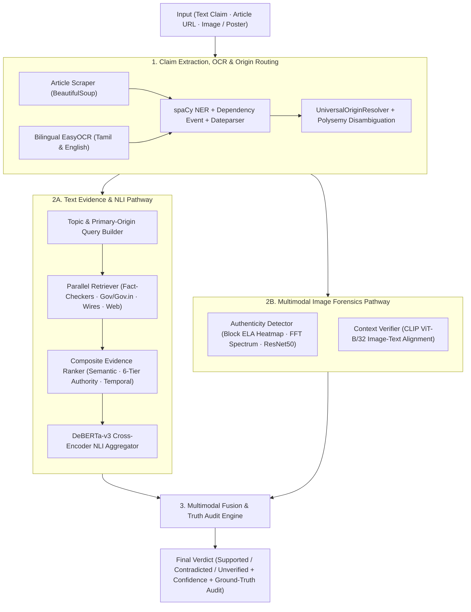

<div align="center">

<p>
  
</p>

# CREDENCEX

### **Trust the evidence. Verify the truth.**

**Multimodal AI-Powered News Verification**  
<sub><code>CREDENCE</code> = Trust / Believability &nbsp;&middot;&nbsp; <code>X</code> = Advanced Intelligence</sub>

<br />

[](https://huggingface.co/spaces/Jeeva-dev/CREDENCEX)
[](Dockerfile)
[](render.yaml)
[](https://www.python.org/)
[](https://fastapi.tiangolo.com/)
[](https://huggingface.co/cross-encoder/nli-deberta-v3-base)
[](https://huggingface.co/openai/clip-vit-base-patch32)
[](https://github.com/JaidedAI/EasyOCR)
[](pytest.ini)

[Live Demo](https://huggingface.co/spaces/Jeeva-dev/CREDENCEX) &nbsp;&middot;&nbsp;
[Overview](#overview) &nbsp;&middot;&nbsp;
[Architecture](#architecture) &nbsp;&middot;&nbsp;
[Quick Start](#quick-start) &nbsp;&middot;&nbsp;
[Deployment](#deployment) &nbsp;&middot;&nbsp;
[Usage](#usage) &nbsp;&middot;&nbsp;
[Web Dashboard & API](#web-dashboard--rest-api) &nbsp;&middot;&nbsp;
[Authority Scoring](#universal-origin--6-tier-authority-scoring) &nbsp;&middot;&nbsp;
[Testing](#testing)

</div>

---

## Overview

**CREDENCEX** is a claim-centric multimodal fact-checking and media forensics platform. Given a **text claim**, **news article URL**, or **suspicious image/poster**, the pipeline decomposes the statement into structured elements, dynamically identifies primary issuing authorities, retrieves and scores cross-domain evidence, runs neural Natural Language Inference (NLI), inspects image authenticity and visual-text consistency, and synthesizes a calibrated **`Supported`**, **`Contradicted`**, or **`Unverified`** verdict with a human-readable truth audit.

### Key Capabilities

| Pillar | What It Does | Core Stack |
|---|---|---|
| **Claim Structuring & Disambiguation** | Extracts entities, main predicate/event, domain, and temporal bounds as $C = (E, V, T, D)$; disambiguates polysemous terms (`WHO` vs. pronoun `who`, `Mars` vs. candy, legislative `bill` vs. person, biological `cell` vs. battery/prison). | `spaCy`, `dateparser`, Regex Rules |
| **Universal Origin Routing** | Dynamically resolves primary sources across governance, central banking, healthcare, astronomy, agriculture, district `.nic.in` collectorates, cinema/production houses, corporate, sports, and live press-speech news coverage. | `UniversalOriginResolver` |
| **Multi-Source Retrieval & Ranking** | Parallel thread-pooled retrieval across Google Fact Check Tools API, DuckDuckGo (fact-check-targeted & general), Snopes, PolitiFact, FactCheck.org, and encyclopedic context, ranked by semantic, authority, and temporal signals. | `all-mpnet-base-v2`, `DDGS`, `BeautifulSoup` |
| **Neural NLI Stance Engine** | Evaluates `entailment`, `contradiction`, and `neutral` probabilities per passage with source-tier weighted aggregation and deterministic numerical/negation/entity-swap fallback checks. | `cross-encoder/nli-deberta-v3-base` |
| **Multimodal Forensics & Bilingual OCR** | Detects JPEG splicing via Error Level Analysis (ELA) heatmaps & FFT spectral analysis, checks ResNet50 manipulation risk, verifies image-claim alignment via CLIP, and extracts Tamil (`ta`) & English (`en`) poster/card text via EasyOCR. | `CLIP`, `OpenCV`, `EasyOCR`, `ResNet50` |
| **Interactive Dashboard & API** | Deep-navy web UI (`/`), Swagger OpenAPI docs (`/docs`), sync & async endpoints, TTL rumor cache, and structured truth-audit breakdown (`rumor_statement` vs. `actual_truth`). | `FastAPI`, `Uvicorn`, `Pydantic v2` |

---

## Architecture



### Evidence Ranking Formula

Retrieved candidate passages are scored and ranked before NLI verification using:

$$S_e = 0.5 \, S_{\text{semantic}} + 0.3 \, S_{\text{reliability}} + 0.2 \, S_{\text{temporal}}$$

- **$S_{\text{semantic}}$**: Cosine similarity between claim and passage embeddings (`sentence-transformers/all-mpnet-base-v2`), with token-overlap/Jaccard fallback.
- **$S_{\text{reliability}}$**: 6-tier domain authority credibility score evaluated dynamically with primary-origin and social-handle validation.
- **$S_{\text{temporal}}$**: Recency and proximity of evidence timestamps relative to claim dates.

---

## Quick Start

### 1. Clone & Create Virtual Environment

```bash
git clone https://github.com/Jeeva-code28/CREDENCEX.git
cd CREDENCEX

python -m venv venv
# Windows (PowerShell / CMD)
venv\Scripts\activate
# Linux / macOS
source venv/bin/activate
```

### 2. Install Dependencies

```bash
pip install -r requirements.txt
```

> [!NOTE]
> `CLIP` runs natively through `transformers>=4.35.0` (`openai/clip-vit-base-patch32`), so no separate external Git installation is required.

### 3. Download spaCy Language Model

```bash
# Transformer NER model (highest accuracy, ~500 MB)
python -m spacy download en_core_web_trf

# Or lightweight model (fast startup, ~12 MB; automatic fallback if transformer model is absent)
python -m spacy download en_core_web_sm
```

### 4. Environment Variables (Optional)

```bash
# Optional: enable Google Custom Search / Google Fact Check API keys
set GOOGLE_API_KEY=your_api_key
set GOOGLE_SEARCH_ENGINE_ID=your_search_engine_id

# Optional: force Hugging Face offline cache mode after models are downloaded
set HF_HUB_OFFLINE=1
set TRANSFORMERS_OFFLINE=1
```

*(On Linux/macOS or PowerShell, use `export VAR=...` or `$env:VAR="..."` respectively.)*

---

## Deployment

### 1. Live Interactive Demo (Hugging Face Spaces)

Experience the live interactive CREDENCEX web dashboard with radial confidence meters, multi-source evidence extraction, and real-time truth audit matrix:

👉 **[Launch Live Demo on Hugging Face Spaces](https://huggingface.co/spaces/Jeeva-dev/CREDENCEX)**

### 2. Docker Container

A multi-stage production [`Dockerfile`](Dockerfile) is provided for containerized deployment:

```bash
# Build the Docker image
docker build -t credencex .

# Run the container (maps port 8000)
docker run -p 8000:8000 credencex
```

### 3. Cloud Deployment (Render Blueprint)

CREDENCEX includes a declarative infrastructure Blueprint specification ([`render.yaml`](render.yaml)):
- Connect your GitHub repository to [Render Blueprints](https://render.com/blueprints).
- Automatic health monitoring on `/api/v1/health`.
- Persistent disk mounting for caching Hugging Face transformer models.

---

## Usage

### Interactive Web Dashboard

Start the FastAPI service and open the interactive dashboard:

```bash
python serve.py --port 8080
```

Once initialized, open:
- **Web Dashboard**: `http://localhost:8080/`
- **Swagger / OpenAPI Docs**: `http://localhost:8080/docs`
- **Health Endpoint**: `http://localhost:8080/api/v1/health`

Available `serve.py` flags:

| Flag | Default | Description |
|---|---|---|
| `--host` | `0.0.0.0` | Network interface to bind |
| `--port` | `8000` | Port to listen on |
| `--reload` | `False` | Enable Uvicorn auto-reload during development |
| `--workers` | `1` | Number of worker processes |

---

### Command Line (`main.py`)

```bash
# Verify a text claim
python main.py --text "NASA James Webb Space Telescope detected water vapor and carbon dioxide on exoplanet K2-18b."

# Verify a news article URL
python main.py --url "https://example.com/news-article"

# Verify a suspicious image, poster, or screenshot (with OCR + ELA/FFT + CLIP)
python main.py --image "path/to/suspicious_image.jpg"

# Specify custom YAML config and output JSON file
python main.py --text "The Earth is flat" --config configs/model_config.yaml --output result.json
```

---

### Python API

```python
from main import NewsVerificationPipeline

pipeline = NewsVerificationPipeline()

result = pipeline.verify(
    "Reserve Bank of India has banned all 500 rupee currency notes starting midnight.",
    input_type="text",
    max_evidence=5,
)

verdict = result["final_verdict"]
print(f"Verdict:    {verdict['final_verdict']}")
print(f"Confidence: {verdict['final_confidence']:.2%}")
print(f"Summary:    {verdict['truth_analysis']['actual_truth']}")
print(result["report"])
```

---

## Web Dashboard & REST API

All REST endpoints are mounted under `/api/v1` (defined in [app.py](src/api/app.py) with Pydantic v2 schemas in [schemas.py](src/api/schemas.py)).

| Method | Endpoint | Description | Response Model |
|---|---|---|---|
| `GET` | `/` | Serves interactive Web UI (or JSON service metadata with `Accept: application/json` / `?format=json`) | HTML / JSON |
| `GET` | `/app` | Serves interactive Web UI | HTML |
| `GET` | `/api/v1/health` | Model load state, CPU/CUDA device, cache size, uptime | `HealthResponse` |
| `GET` | `/api/v1/sources` | Lists indexed fact-checking & news wire sources with credibility weights | `List[SourceCredibilityItem]` |
| `POST` | `/api/v1/verify` | Verify a `text` claim or news `url` (supports `max_evidence`, `bypass_cache`, `async_mode`) | `VerdictResponse` / `202 Accepted` |
| `POST` | `/api/v1/verify/image` | Multipart upload (`image`/`file`) + optional `text`/`claim_text` for ELA, FFT, OCR & CLIP | `VerdictResponse` / `202 Accepted` |
| `POST` | `/api/v1/verify/async` | Explicitly enqueue a background verification task | `JobStatusResponse` (`202`) |
| `GET` | `/api/v1/jobs/{job_id}` | Poll status & result of an async verification job | `JobStatusResponse` |
| `DELETE` | `/api/v1/cache` | Clear the in-memory TTL claim cache | JSON |

**Example `curl` Request:**

```bash
curl -X POST http://localhost:8080/api/v1/verify \
  -H "Content-Type: application/json" \
  -d '{
    "text": "The Earth is flat and NASA has been covering up the truth about the planetary curve.",
    "max_evidence": 5,
    "bypass_cache": false
  }'
```

---

## Universal Origin & 6-Tier Authority Scoring

[`get_domain_authority_score`](src/authority_sources.py) evaluates source URLs algorithmically with strict host boundary matching (preventing domain spoofing and URL-slug handle spoofing):

| Tier | Score | Source Class | Examples |
|---|---|---|---|
| **Tier 1** | `0.99` | Verified Primary Origin, Gov Portals, Intergovernmental Agencies, Peer-Reviewed Journals | `*.gov`, `*.gov.in` (`pib.gov.in`), `*.nic.in` (context-gated), `who.int`, `nasa.gov`, `isro.gov.in`, `rbi.org.in`, `nature.com`, `thelancet.com`, official entity `x.com/<handle>` |
| **Tier 2** | `0.95` | Certified IFCN Fact-Checking Networks & Desks | `youturn.in`, `boomlive.in`, `altnews.in`, `snopes.com`, `politifact.com`, `factcheck.org`, `fullfact.org`, `reuters.com`, `apnews.com` |
| **Tier 3** | `0.92` | Primary News Wire Services | `ptinews.com`, `aninews.in`, `afp.com`, `bloomberg.com`, `ians.in`, `upi.com` |
| **Tier 4** | `0.90` | Accredited Regional & National Mainstream Press | `thehindu.com`, `puthiyathalaimurai.com`, `thanthitv.com`, `indianexpress.com`, `bbc.com`, `nytimes.com`, `usatoday.com` |
| **Tier 5** | `0.85` | Peer-Reviewed Editorial Knowledge Bases | `britannica.com` |
| **Web Default** | `0.60` | Standard Web Pages, Blogs, Unrelated Portals | General websites |
| **Tier 6** | `0.45` | Unverified Social Media & Forums | Non-verified accounts on `x.com`, `reddit.com`, `facebook.com`, `instagram.com`, `youtube.com` |
| **Disallowed** | `0.00` | Open-Edit / Crowd-Sourced Wikis (excluded from primary scoring) | `wikipedia.org`, `wikimedia.org`, `fandom.com` |

---

## Configuration

All default hyperparameters and thresholds live in [configs/model_config.yaml](configs/model_config.yaml):

| Key | Default | Purpose |
|---|---|---|
| `claim_extraction.ner_model` | `en_core_web_trf` | spaCy NER model (falls back to `en_core_web_sm` if absent) |
| `evidence_retrieval.semantic_model` | `sentence-transformers/all-mpnet-base-v2` | Sentence embedding encoder for passage similarity |
| `evidence_retrieval.top_k` | `10` | Maximum ranked evidence items passed to NLI |
| `evidence_ranking.weights` | `{0.5, 0.3, 0.2}` | Weights for semantic, reliability, and temporal scores |
| `nli_model.model_name` | `cross-encoder/nli-deberta-v3-base` | Cross-encoder NLI classifier |
| `nli_model.batch_size` | `32` | Inference batch size |
| `image_auth.cnn_model` | `resnet50` | Backbone when fine-tuned manipulation checkpoint exists |
| `image_auth.ela_threshold` | `0.7` | Error Level Analysis threshold |
| `image_auth.authenticity_threshold` | `0.6` | Score cutoff for authentic verdict |
| `image_context.clip_model` | `openai/clip-vit-base-patch32` | Vision-language alignment model |
| `fusion.thresholds` | `{0.70, 0.70, 0.50}` | Verdict thresholds (`supported`, `contradicted`, `unverified`) |
| `performance.retrieval_workers` | `10` | Concurrent retrieval workers |
| `performance.cache_enabled` | `true` | Enable in-memory verification cache |

---

## Project Structure

```text
CREDENCEX/
├── configs/
│   └── model_config.yaml                 # Pipeline, model, fusion & performance config
├── src/
│   ├── api/
│   │   ├── __init__.py
│   │   ├── app.py                        # FastAPI server, async job runner & endpoints
│   │   ├── cache.py                      # Thread-safe TTL claim verification cache
│   │   └── schemas.py                    # Pydantic v2 request/response contracts
│   ├── web/
│   │   ├── index.html                    # CREDENCEX web dashboard markup
│   │   ├── styles.css                    # Deep Navy & Periwinkle-Indigo UI stylesheet
│   │   ├── app.js                        # Interactive client logic, stepper, gauges & forensics viewer
│   │   └── samples/generate_samples.py   # Sample media generator utility
│   ├── __init__.py
│   ├── authority_sources.py              # UniversalOriginResolver, polysemy & 6-tier scorer
│   ├── claim_extraction.py               # Single-pass spaCy NER, temporal & event parser
│   ├── evidence_retrieval.py             # Multi-source retrieval & URL/shingle deduplication
│   ├── evidence_ranking.py               # Semantic + reliability + temporal composite ranker
│   ├── nli_verification.py               # DeBERTa cross-encoder NLI + deterministic fallback
│   ├── image_authenticity.py             # Block ELA heatmaps, FFT spectral risk & ResNet50
│   ├── image_context.py                  # CLIP image-text consistency & visual attributes
│   ├── image_ocr.py                      # Bilingual EasyOCR (Tamil & English poster extractor)
│   ├── fusion_engine.py                  # Multimodal verdict fusion & truth-audit synthesizer
│   └── utils.py                          # Logging, YAML loader & timing decorator
├── tests/
│   ├── test_adversarial_and_edge_cases.py
│   ├── test_api.py
│   ├── test_authority_routing.py
│   ├── test_claim_extraction.py
│   ├── test_concurrency_and_stress.py
│   ├── test_fusion_matrix.py
│   ├── test_homophones_and_context.py
│   ├── test_image_modules.py
│   ├── test_image_ocr.py
│   ├── test_overfit_underfit_fixes.py
│   ├── test_pipeline.py
│   ├── test_real_world_benchmarks.py
│   ├── test_retrieval.py
│   ├── test_speech_and_press_meets.py
│   └── test_universal_origin.py
├── main.py                               # CLI entry point & NewsVerificationPipeline
├── serve.py                              # FastAPI/Uvicorn launcher
├── pytest.ini                            # Pytest marker configuration
├── pyrightconfig.json                    # Pyright / Pylance IDE configuration
├── requirements.txt                      # Python dependencies
└── README.md
```

---

## Testing

The test suite covers authority routing, polysemy disambiguation, evidence deduplication, NLI calibration, image forensics (ELA/FFT/CLIP/OCR), adversarial inputs, concurrency, and FastAPI endpoints:

```bash
# Fast unit tests (skip heavy integration/network tests)
python -m pytest tests/ -v -m "not integration"

# Targeted authority, disambiguation & regression suites (offline cache mode)
HF_HUB_OFFLINE=1 TRANSFORMERS_OFFLINE=1 python -m pytest tests/test_authority_routing.py tests/test_universal_origin.py tests/test_homophones_and_context.py tests/test_overfit_underfit_fixes.py -v

# API test suite
HF_HUB_OFFLINE=1 TRANSFORMERS_OFFLINE=1 python -m pytest tests/test_api.py -v

# Full test suite with coverage report
python -m pytest tests/ -v --cov=src --cov-report=term-missing
```

---

## Ablation Study Results

Reported progression across incremental pipeline modules:

| Configuration | Macro-F1 |
|---|---:|
| Baseline (No Modules) | 77.3% |
| + Evidence Retrieval | 84.1% |
| + Source Reliability | 85.0% |
| + Temporal Relevance | 86.1% |
| + Image Authenticity | 86.9% |
| + Context Verification | 88.4% |
| **Complete System** | **91.0%** |

---

## License

This project is provided for **research and educational purposes**.
